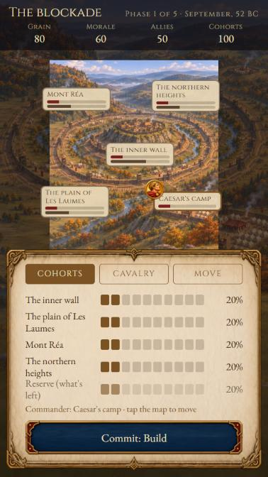
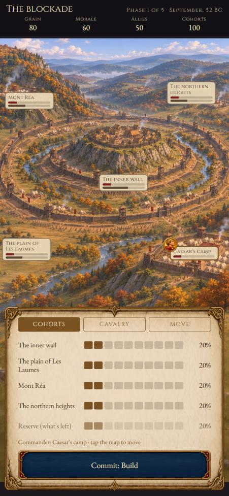
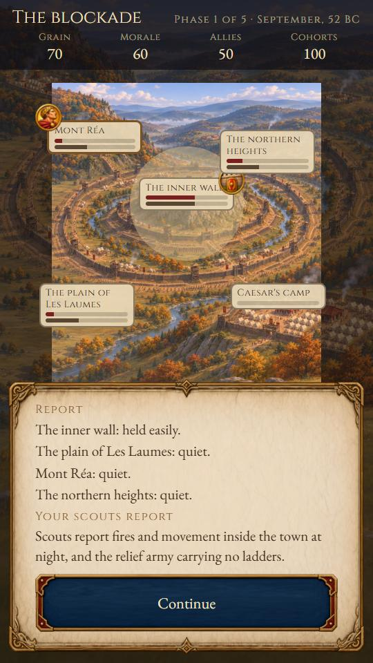
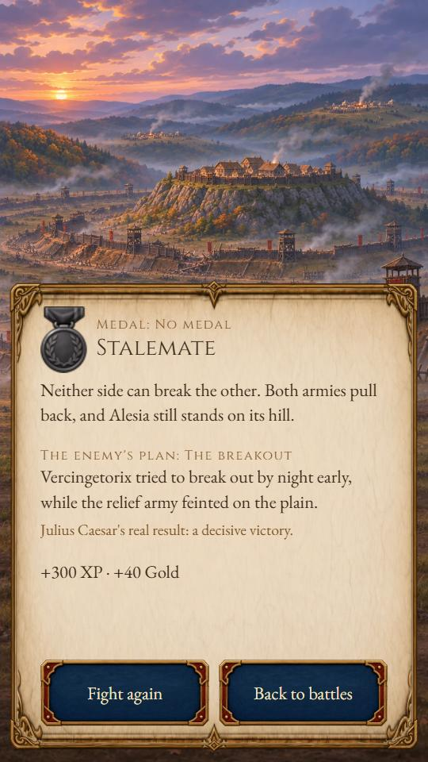

# Task 17 report: battle mode, with Alesia

Branch `task-17-battle-mode`. `npm test` passes: 8,039 tests, 2 skipped (the avatar sheet tests,
as before). `npx tsc --noEmit` is clean. All 867 Alesia fixtures pass in the TypeScript runtime and
in `battle.py` (`npm run battle-fixtures`). Every earlier ruler's fixtures still pass.

## How the runtime is built for future battles

- **`src/battle/`** is pure TypeScript with no React or Expo imports. The purity test now covers it.
  - `types.ts` holds the data types.
  - `runtime.ts` holds the phase loop.
  - `sliders.ts` holds the step maths.
  - `plan.ts` picks the hidden plan from the seed.
  - `alesia.ts` holds Alesia's own effects.
- **`runtime.ts` is generic.** It runs a phase in `battle.py`'s order and calls the battle's module
  at each point:
  1. the move's immediate effects;
  2. pressure, from `battle.json` × `pressureScale`, then the module's scaling;
  3. the reserve;
  4. a scene shown during the phase;
  5. each sector's result: defence × `commanderBonus`, banded by `battle.json` `bands`;
  6. endings checked straight after the fighting;
  7. consequences;
  8. the move's after-effects;
  9. upkeep;
  10. the end-of-phase endings;
  11. the outcome.

  These also come from the data:
  - when scenes appear (`before`, `during`, `after: victory`);
  - the moves per phase and slider steps;
  - the plans;
  - which outcomes are victories (those with a medal reward).

  Unlockables are evaluated when the battle ends, after the surrender scene for a victory.
- **`BattleModule`** (`src/battle/types.ts`) is the small interface a battle supplies: its state, and
  its move, scene and outcome effects. `alesia.ts` is the only Alesia-specific code in the runtime.
  Changing scouting's balance is an edit to `applyMoveBefore` there. A second battle adds:
  - `content/battles/<id>/`;
  - a module;
  - one line in `src/data/battles/index.ts`.
- **The hidden plan** comes from a seed stored with the battle (a hash of it picks one of
  `battle.json` `plans`).
  - Saves store the seed and the player's actions, never the plan, and resume by replaying them.
  - Tests check the plan is unchanged across save and resume at every point in a battle, and that
    the save never names it.
  - The plan is shown only on the result card. The scouting clue appears in the report when the
    move was Scout, as the task asks.
- **Game layer** (`src/game/`):
  - `battleSession.ts`: sessions and saves.
  - `battlePersistence.ts`: save, load, and recording a battle once.
  - `battleRecord.ts`: the profile record and rewards.
  - `battleView.ts`: what the menu and profile may show.
  - The profile is now **version 6**, with a `battles` section. Versions 1–5 migrate unchanged.

## Differences between `battle.json` and `battle.py`

I checked every value the two share and none disagree:

- pressures;
- moves per phase;
- scene options;
- terrain;
- commander positions;
- plans;
- all twelve tuning values;
- bands;
- pool sizes and steps.

What `battle.json` doesn't contain, so it stays in code, mostly in `alesia.ts`:

- **Starting values** for morale (60), allies (50), relief (100) and hunger (40).
- **The "quiet" threshold:** pressure ≤ 0.5 gives no fighting. It is `QUIET_PRESSURE` in
  `runtime.ts`.
- **The bronze thresholds:** cohorts < 60 or morale < 25.
- **Every move and scene effect.** The task allows these to stay in code.

One quirk is kept on purpose because the fixtures depend on it. Gold is downgraded to silver when
the army is too weak, but "relief army destroyed" is still recorded as true. The Eagle Flies Free
reads that recorded value.

## Simulator

`python tools/simulate.py battle alesia [N] [ITERS]` (or `npm run battle-report`) runs
`tools/battle_sim/report.py` on the reference model. The four player types play each plan in turn,
with sliders in their steps. I made `sim.py` importable by moving its command-line dispatch under a
main guard; the model itself is untouched. Results from 20,000 battles per type:

| Player | Early end | Gold | Silver | Bronze | Any medal | Gold by plan (hist / north / hunger / breakout) |
| --- | --- | --- | --- | --- | --- | --- |
| Careless | 34.6% | 0.0% | 7.5% | 0.6% | 8.2% | 0 / 0.1 / 0 / 0% |
| Thoughtful, never reads the plan | 25.0% | 0.0% | 58.6% | 8.2% | 66.9% | 0 / 0 / 0 / 0% |
| Reads the plan by phase 4 | 25.0% | 50.0% | 25.0% | 0.0% | 75.0% | 100 / 0 / 0 / 100% |
| Scouts in phase 1 | 25.0% | 16.7% | 58.3% | 0.0% | 75.0% | 33 / 0 / 0 / 33% |

- **Unlockables reached:**
  - Careless players reach Gaul Unbound 7.7%, Red Cloak 3.5%, Iron Ring 3.2%, Clemency 0.8% and
    Hunter Hunted 0.4%.
  - Readers reach Iron Ring 75%, Red Cloak 25%, Clemency 8% and Throws Down His Arms 5.6%.
  - The Eagle Flies Free appears only through a hill-climbed strategy.
- **Dominance:** the best strategy found for each plan wins gold only against its own plan. The
  most robust single strategy wins gold against 3 of 4 plans (historical, hunger, breakout; silver
  against northern). **No strategy wins gold against every plan.**
- **Caesar's sketched plan** gets silver against historical and breakout, a stalemate against
  northern, and siege lifted against hunger.

These match the expected figures: careless players end early about a third of the time; readers win
gold about half the time and non-readers never; the best all-round strategy wins gold against at
most three plans.

Gaul Rises Behind You (allies at zero) happened 0.0% of the time in the simulator, as the task says.
A unit test drives allies to zero. There are unit tests for all five early endings.

## Progression, profile, achievements

- **XP:** 10 per phase played (the per-decision rate) × the battle's tier, 2 from `battle.json`, plus
  the first-time ending bonus × 2. A full battle with a new ending earns 300 XP.
- **Gold** is paid at the ruler rate (band × tier) for each first-time ending and each first-time
  unlockable. Separately, the first gold, silver and bronze medals pay 100, 60 and 30 once each,
  from `battle.json`.
  - All of it goes through the existing ledger: once per battle id, with the record saved before the
    save is cleared.
  - Tests cover gold, then silver, then bronze, each paid once.
- **The gold bands are provisional and need your call.** They are new, in `progression.json`
  `currency.battles.alesia`, taken from the simulator's share of each ending across the four player
  types (≥5% common, ≥1% uncommon, ≥0.1% rare, else legendary):

  | | Common | Uncommon | Rare | Legendary |
  | --- | --- | --- | --- | --- |
  | **Endings** | gold, silver, stalemate, siege lifted | bronze, trapped | death, army breaks | Gaul rises |
  | **Unlockables** | red cloak, iron ring, clemency | throws down arms, Gaul unbound | hunter hunted | eagle free |

- **Profile:** a new Battles section. For each battle it shows:
  - battles fought;
  - best medal;
  - endings and unlockables reached, as counts and names, with unreached ones as "???";
  - the plans faced, with unfaced ones as "???" and a ✓ for plans beaten.
- **Achievements:**
  - First Command;
  - Gold at Alesia;
  - Every Plan (a medal against each plan, not just facing it);
  - Alesia Complete, which is hidden.

  They use placeholder badges and are listed as pending in the badge test.
- **Unlocking** reads the profile's Caesar record, so endings reached before this task count. Tests
  cover a version 5 save with a Caesar ending. The testing switch opens Alesia too.

## Screens

- **The title screen** has Profile and Battles side by side.
- **The Battles menu** shows the BMODE1 banner and a card per battle. A locked card says "Complete a
  run as Julius Caesar."; the card shows the best medal and the counts.
- **The battle:**
  - The intro is shown over the day map.
  - Decision scenes use the ruler scenes' read-then-decide panel, followed by a consequence.
  - On the map screen, the battlefield band of the map fits the space between the header and the
    phase panel. On a short screen the map is narrower than the phone and a dimmed copy fills the
    sides, so every sector stays in view.
  - Each sector's marker shows its name, a men bar and a works bar. After a phase it also shows its
    result icon, and the commander token marks where you stand.
  - The phase panel has tabs for Cohorts, Cavalry and Move:
    - drag or tap a slider in its steps;
    - the reserve takes whatever is left, so the total is always 100%;
    - raising a sector takes from the reserve first, then from the largest other sector;
    - the moves show their icons and descriptions;
    - you tap the map to place the commander, then Commit.
  - **The report:** attacked sectors breathe with dust by day or torchlight by night, the bars
    settle to their new values, and the result lines follow, with the scouting clue after Scout.
    Reduce Motion stills the glow and the bars.
  - **The result card** shows:
    - the outcome image and text, and the medal;
    - the unlockables with their images;
    - the plan, revealed;
    - "Julius Caesar's real result: a decisive victory.";
    - the XP and gold, then the rewards panel (phases, battle difficulty and itemised gold).

I played a full battle in the web preview: the scenes appeared at their points, the crisis came
after Commit in phase 5, and the battle ended in a stalemate against the breakout plan. It paid
300 XP and 40 gold and awarded First Command, and the profile then showed the battle.

Screenshots, in `docs/tasks/task17_screens/`:

| Small phone, 360 × 640 | Large phone, 430 × 932 |
| --- | --- |
|  |  |
|  | |
|  | |

## Images and sector positions

- `npm run images` now also writes `src/ui/battle/battleArt.ts`. It contains:
  - the battle images (all 24 present);
  - the 25 icons;
  - the banner;
  - each battle's sector positions.
- Missing images fall back to the placeholder, and a test checks this.
- **`alesia_map_sectors.json`** is in `assets/battles/alesia/`. I traced it from the art chat's
  annotated map: an anchor and an outline per sector, as fractions of the 941 × 1672 map. The
  annotated image matches the map's top 1,150 pixels exactly.
  - `npm run images` picks it up in place of the placeholder
    (`content/battles/alesia/map_sectors.placeholder.json`, kept as the fallback).
  - The map screenshots above use the real positions.

## Text

- All player-facing battle text comes from `text.en.json`. The shared UI words are in
  `strings.en.json` `battles`.
- I added one line to `text.en.json`: `battle.real_result` ("a decisive victory"), for the result
  card.
- **No content linter exists in the repo**, as Task 13 also found. `tests/battle/text.test.ts` lints
  the battle text instead:
  - every id has its text;
  - result lines carry `{sector}`;
  - lengths stay within the longest text of each kind the rulers already ship.
- Three pieces run long. Long text scrolls rather than breaking. The test lists them, so any new
  overrun fails:
  - phase 1 text (150 characters, against 147 for era text);
  - phase 5 text (158 against 147);
  - the card blurb (93 against a 78-character tagline).

## For your decision

1. **The sector bars.** The task asks for a men bar and a **morale** bar per sector, but the model
   has one army-wide morale (shown in the header). Each sector does have its own works value
   (fortification), so the second bar shows works. If you want per-sector morale it needs a model
   change, or the army's morale could be repeated on every sector.
2. **The gold bands** above are provisional.
3. **The three text overruns** above.
